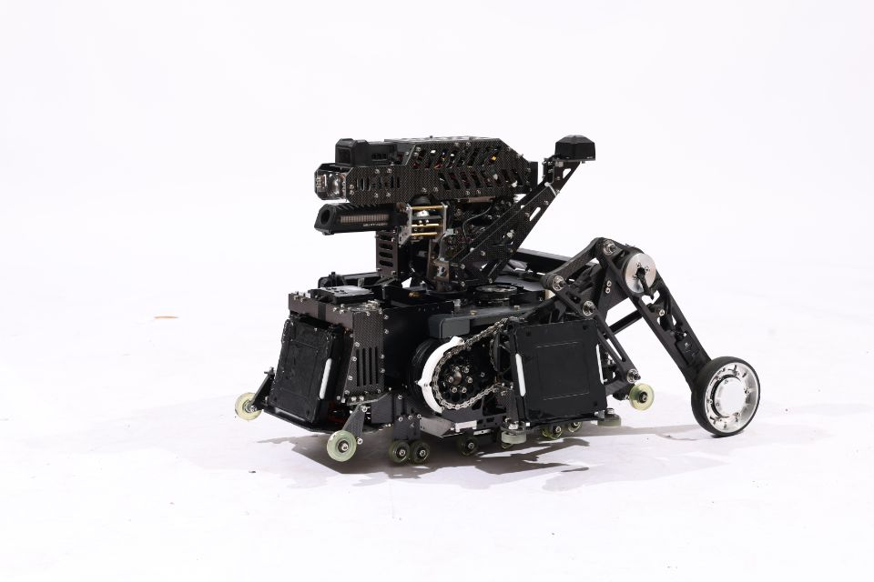

# PinyCore

<p align="center">
    <a href="http://commitizen.github.io/cz-cli/"></a>
    <a href="https://github.com/semantic-release/semantic-release"></a>
</p>

# 📃TODO
## 轮足底盘
### 基础功能
- [x] 基础平衡与制动
- [x] 滚转角控制
- [x] 腿长控制
- [ ] 功率控制
### 进阶功能
- [x] 滞空控制优化
- [x] 小位移自启
- [x] 小陀螺
- [x] 原地跳跃
- [x] 台阶跨越（非跳跃方法）
- [ ] 台阶跨越（跳跃方法）
- [x] 稳定飞坡
- [x] 翻倒自救
- [x] 气弹簧补偿
- [x] 异常检测
- [x] 全向移动
- [x] 车体前后同一化
## 双轴云台
- [x] IMU控制
- [x] 自瞄控制优化
- [ ] 避让腿与自恢复
## 发射机构
- [x] 连发
- [x] 单发
- [x] 防堵转
- [ ] 限热量
## 其他
- [x] UI
- [x] 键鼠控制
- [x] 比赛模式
- [ ] 离线日志

****

👉 [Click here to view details](./.docs/profile.md)

# 🎯Requirements

1. cmake >= 3.24
2. ninja >= 1.1
3. [arm-none-eabi-toolchains](https://developer.arm.com/downloads/-/arm-gnu-toolchain-downloads) >= 10.3.1 or [llvm](https://github.com/arm/arm-toolchain) (experimental)
4. python >= 3.2
5. [kconfiglib](https://github.com/ulfalizer/Kconfiglib)

we also suggest to install following software:
1. [clangd](https://clangd.llvm.org/) >= 20.0
1. clang-format >= 20.0
2. [commitizen](https://github.com/commitizen/cz-cli)
3. ccache

# 🌟Getting started
## 🏗️Build

**构建**

```sh
cmake -B build -G Ninja
```

**编译**

```sh
ninja -C build
```

****

支持基于Kconfig对项目进行配置

```sh
cmake --build ./build --target menuconfig
```

支持直接根据预制的配置文件来构建项目 (应存在于根目录，本例文件名为"yourconfig")

```sh
cmake -B build -G Ninja -DCONFIG_NAME=yourconfig
```

## 🐞Debug

1. openocd >= 0.12.0
2. [cortex-debug](https://github.com/Marus/cortex-debug) / [codelldb](https://github.com/vadimcn/codelldb) (vscode-plugin)
3. Ozone 3.24
4. FreeMASTER/FreeMASTER Lite >= 3.1.3 (后者支持Linux，需装前置Java JRE)
5. systemview

## ⚠️Notice

1. 在main函数执行之前调用HAL库函数是危险的！请避免使调用HAL库的构造函数的类对象成为全局变量（可以创建全局的指针，或使用./Src/Utils/Lazy中的工具，并在初始化阶段构造）；
1. 首次构建时，本项目会自动从github拉取第三方库，请确保网络可用。

## 🧩Framework


# 🙌Contributing

Contributions are always welcome!

See [CONTRIBUTING](./.docs/CONTRIBUTING.md) for ways to get started.

Please adhere to this project's [CODE_OF_CONDUCT](./.docs/CODE_OF_CONDUCT.md).

> [!IMPORTANT]
> PinyCore is still in early development, and is not yet complete. It should be stable enough and we have
> been daily driving it for quite a while, but expect some bugs and possibly breaking changes to the
> config file.
